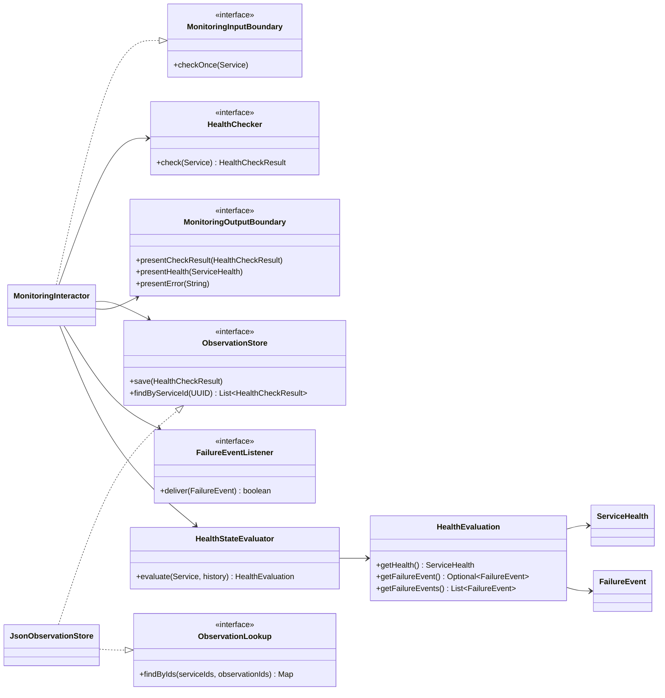
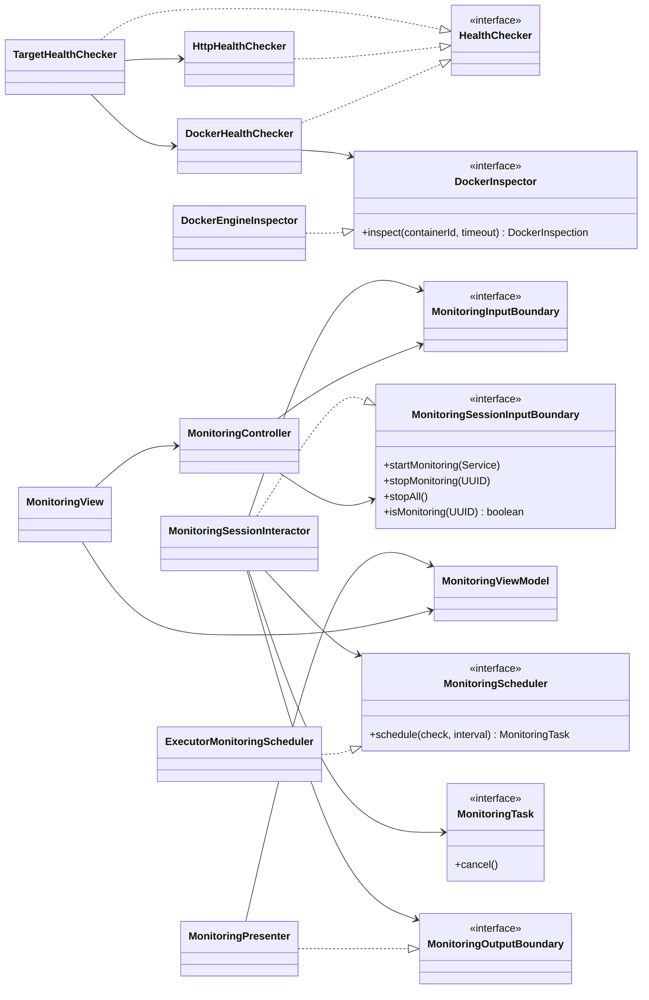
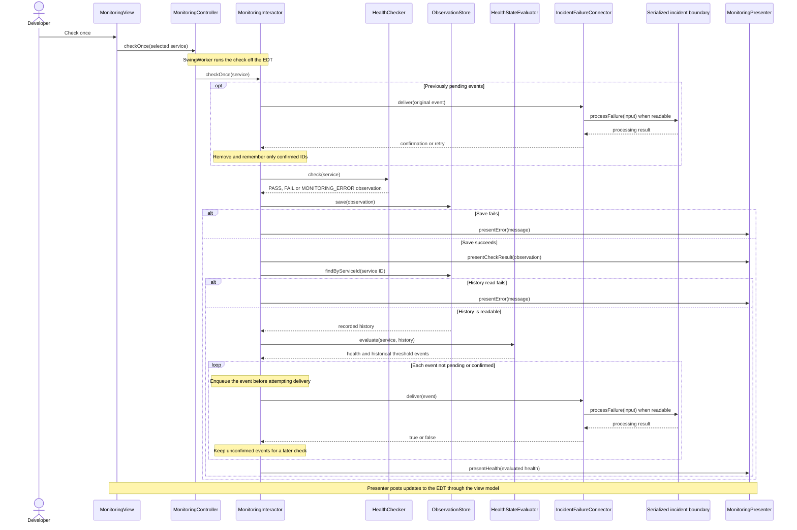
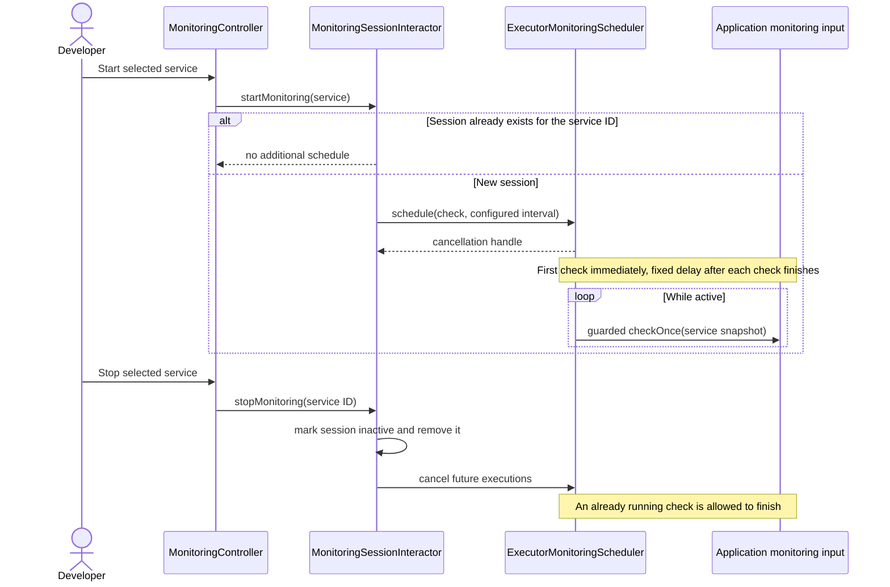

# UC2: Monitor Service Health — Architecture

This document explains the complete structure of Use Case 2, from health-state evaluation to HTTP,
Docker, persistence and the monitoring UI. The user story is in the [README](../README.md#use-case-2).
Its structure follows the [UC4 architecture document](uc4-recover-service.md), with UC2-specific rules
and diagrams reflecting the current implementation.

## Scope

UC2 lets a developer monitor saved services and inspect the evidence behind their health status:

1. Select a configured system and service supplied by UC1.
2. Run a single check or start periodic checks using that service's target, interval and timeout.
3. Save each observation before presenting it or evaluating its history.
4. Apply consecutive-failure and consecutive-recovery thresholds to derive service health.
5. Deliver threshold-crossing failure events to UC3, retaining unconfirmed events for retry.
6. Show observations and evaluated health, and allow the developer to stop monitoring.

The Monitor tab starts one selected service at a time; multiple service sessions can coexist.
Monitoring does not automatically restart when the application opens. UC1 remains the source of saved
configuration. UC3 owns incident investigation and correlation; UC4 owns recovery operations and
resolution verification. UC2 provides observations to those use cases without executing recovery.

## Layer map

| Layer | Types | Responsibility |
| --- | --- | --- |
| Entities (`entity`) | `Service`, `MonitoringTarget`, `MonitoringPolicy` | Immutable configured service identity, target and monitoring thresholds. |
| Entities (`entity`) | `HealthCheckResult`, `ServiceHealth`, `HealthStatus`, `FailureEvent` | Recorded observations, evaluated state and threshold-crossing evidence. |
| Use case (`use_case.monitor_service_health`) | `MonitoringInputBoundary`, `MonitoringInteractor`, `MonitoringOutputBoundary` | Coordinate one check, storage, evaluation, event delivery and presentation. |
| Use case | `HealthStateEvaluator`, `HealthEvaluation` | Pure replay of observation history and deterministic failure-event generation. |
| Use case | `MonitoringSessionInputBoundary`, `MonitoringSessionInteractor` | Manage active sessions, prevent duplicate starts and cancel future checks. |
| Use-case ports | `HealthChecker`, `ObservationStore`, `ObservationLookup`, `FailureEventListener`, `MonitoringScheduler`, `MonitoringTask` | Define checking, storage, evidence lookup, delivery and scheduling capabilities. |
| Interface adapters | `MonitoringController`, `MonitoringPresenter`, `MonitoringViewModel` | Translate UI actions, dispatch checks off the EDT and maintain per-service display state on the EDT. |
| Checking adapters (`data_access`) | `TargetHealthChecker`, `HttpHealthChecker`, `DockerHealthChecker` | Select the configured checking method and translate observations into UC2 outcomes. |
| Docker transport (`data_access.docker`) | `DockerInspector`, `DockerInspection`, `DockerEngineInspector` | Read and decode the stable subset of an Engine inspect response. The inspector seam permits fake-based tests. |
| Persistence (`data_access.persistence`) | `JsonObservationStore`, shared `JsonCodec` | Store immutable JSON observations and implement history/scoped lookup. `InMemoryObservationStore` remains an alternative implementation. |
| Infrastructure and view | `ExecutorMonitoringScheduler`, `MonitoringView` | Fixed-delay scheduling and the Swing Monitor panel. |
| Composition root (`app`) | `Sentinel`, its `MonitoringApplication` and `MonitoringExecution` helpers | Construct concrete adapters, share the clock/store and coordinate shutdown. |
| UC3 adapters used | `IncidentFailureConnector`, `ObservationLookupReader` | Translate UC2 events and stored evidence into UC3 contracts. |

The inner layers import no Swing, Docker SDK, HTTP-client or JSON implementation. Concrete outer
components implement the inner ports and are selected in `Sentinel`.

## Class diagrams

### Single checks, evaluation and evidence



`getFailureEvent()` describes the current unhealthy episode, if any. `getFailureEvents()` returns all
threshold crossings in the supplied history, including episodes followed by recovery. The interactor
uses the latter so that an earlier history-read failure does not permanently lose a threshold crossing.

### Sessions and outer components



The clock, HTTP client and application composition are omitted from the diagrams for readability.
They are outer-layer dependencies; the evaluator itself needs only a service and its recorded history.

## Execution sequences

### Check once and deliver a failure



The listener can acknowledge a removed service without calling UC3, but only when a complete
configuration listing confirms its absence. A service ID found in multiple systems is reported as a
configuration conflict and acknowledged. Configuration/history access failures retain the event for
retry. For a readable owner, UC3's `PROCESSED` and `REJECTED` are terminal; `RETRYABLE` is not.

### Start and stop monitoring



## Health rules and event identity

History is copied, checked for distinct observation IDs belonging to the requested service, then sorted
by timestamp and UUID. Empty history produces `UNKNOWN`. Evaluation replays the full history using
the service's current policy.

| Observation | Counters | Evaluated state |
| --- | --- | --- |
| PASS | Clear failures; increment consecutive passes. | Set HEALTHY at the recovery threshold; otherwise retain the previous state. |
| FAIL | Clear passes; append to the consecutive failure evidence. | At the failure threshold, set UNHEALTHY and create an event if not already UNHEALTHY. Otherwise retain the previous state. |
| MONITORING_ERROR | Clear both streaks. | Set UNKNOWN and clear the current-episode event. Historical events remain in the evaluation result. |

A negative observation and an unhealthy service are different concepts. With failure threshold 2 and
recovery threshold 3, `PASS PASS PASS FAIL` leaves the evaluated service HEALTHY until the failure
threshold is reached. UC4's fresh trailing-pass verification is intentionally stricter; its verifier
and UC2's evaluator are not interchangeable.

An event's ID is derived from `"monitoring-failure:" + crossingObservationId` using `UUID.nameUUIDFromBytes`
and UTF-8. Replaying the same ordered history under the same policy reproduces the crossing ID.
The event contains the consecutive FAIL observations through that crossing and uses its timestamp.
Further FAILs in the same unhealthy episode do not generate another crossing event.

For threshold 2, `FAIL FAIL ERROR FAIL FAIL` produces two events. The error means unknown health and
resets detection; UC3 can correlate the two events into one continuing incident when no PASS intervenes.
That is separate from UC2's detection rule.

## Delivery, retries and persistence

`MonitoringInteractor` keeps a `LinkedHashMap<UUID, FailureEvent>` of pending events and a set of
confirmed IDs. Before each check it retries pending events, preserving the original object and ID.
New events enter the map before delivery. `false` or a runtime exception leaves them pending; `true`
removes them and records their IDs so replayed history cannot repeatedly deliver them in that process.
There is no separate retry timer: a later check, including one for another service, triggers retry.

All historical crossings are considered after a successful history read. This handles a read failure
on the exact crossing check, including a service that recovers before its history becomes readable.
The observation is saved before presentation; failed saves stop that check's presentation/evaluation.

`JsonObservationStore` implements both `ObservationStore` and `ObservationLookup`. It stores schema
version 1 at `<application-data>/observations/<observation-id>.json`, using shared `JsonCodec` operations.
All outcomes, original IDs, nanosecond timestamps, optional response times and messages survive restart.
An identical repeated save is idempotent; conflicting contents for an existing ID are rejected.

Writes use temporary files followed by atomic moves. Unsupported atomic moves fail. Corrupt or
disappearing listed records fail history reads instead of silently shortening a threshold streak.
Lookup omits missing and out-of-scope IDs; malformed requested records raise `ObservationStoreException`.
Returned collections are independent, unmodifiable snapshots. Calls on the shared store are synchronized.

The pending map and confirmed set are not persisted. On subsequent checks after restart, the evaluator
reconstructs crossings from durable history and UC3 acknowledges previously processed failure IDs.
This is replay with acknowledgement, not an exactly-once delivery guarantee. Old observations that
existed only in memory before JSON storage was introduced cannot be recovered.

## Check adapters

### HTTP

`HttpHealthChecker` performs a GET against the saved endpoint with its configured request timeout.
HTTP 2xx produces PASS; other received HTTP status codes produce FAIL. Connection/I/O failures,
timeouts and interruption produce MONITORING_ERROR. Interruption restores the thread's interrupt flag.
Elapsed response time uses `System.nanoTime`; observation timestamps use the injected application clock.

### Docker

`DockerHealthChecker` translates `DockerInspector` results. `DockerEngineInspector` uses `docker-java-core`
and `docker-java-transport-httpclient5`, pinned to 3.7.1, for host/context/TLS configuration and transport.
It makes only `GET /containers/{encoded-id-or-name}/json` requests; the target occupies one encoded
path segment. It reads stable inspect fields through the existing JSON codec and caps responses at 1 MiB.
Unversioned requests use the daemon's current API. No CLI subprocess or recovery operation is invoked.

| Docker observation | UC2 outcome |
| --- | --- |
| Running with healthy HEALTHCHECK | PASS |
| Running without HEALTHCHECK or with health `none` | PASS, explicitly labelled **runtime state only** |
| Running with unhealthy HEALTHCHECK or OOMKilled reported | FAIL |
| Created, paused, restarting, exited, dead, removing | FAIL |
| Engine returns 404 for the target | FAIL: container missing |
| Running with health `starting` | MONITORING_ERROR: health is not known yet |
| Connection failure, timeout, denied permission, server error or uninterpretable response | MONITORING_ERROR |

A running container without HEALTHCHECK is not proof of application readiness. The message identifies
that this observation checks only runtime state. Every result uses the same application clock as UC3.

Each inspect opens and closes its client so services do not share mutable timeout settings. The policy
timeout bounds the connection and response phases individually; it is not a hard deadline for their sum.
Positive sub-millisecond values round up to one millisecond to avoid becoming an unlimited timeout.

Docker Desktop/Engine must be running for real checks. The client reads its standard host/context/TLS
configuration. Defaults are the Windows `docker_engine` named pipe and `unix:///var/run/docker.sock`
on Unix. The Java property `sentinel.docker.host` can override the host without changing Engine settings:

```powershell
java "-Dsentinel.docker.host=npipe:////./pipe/docker_engine" -cp "target/classes;target/dependency/*" app.Sentinel
```

Use the local socket/pipe or a properly configured TLS connection; monitoring does not require enabling
an unauthenticated TCP listener.

## Integration, UI and lifecycle

`Sentinel.wireMonitoring` constructs the target router, checkers, single-check interactor and session
interactor, then returns their input boundaries together with UC3's investigation inputs.
`wireInvestigateIncident` uses the same observation store for history and lookup, and returns the
`IncidentFailureConnector` passed into UC2. UC3 processes incident work on its shared serialized worker.
`ObservationLookupReader` translates `ObservationStoreException` into UC3's `IncidentDataException`.
UC4 reads service history through `ObservationStore` for its own verification window.

UC1's presenter output refreshes the saved-system list in the Monitor tab and upserts saved systems.
`MonitoringController.reconcileServices` compares active service snapshots with the updated roster.
Changed or removed services stop their old schedules; unchanged services continue. Restarting an
updated service is an explicit developer action. A check already running may still complete.

Manual checks use `SwingWorker`. Periodic checks use one `ScheduledThreadPoolExecutor` with fixed delay,
and session cancellation marks callbacks inactive and cancels future executions without interruption.
Unexpected runtime errors in a periodic check are presented so later scheduled checks can still run.
`MonitoringPresenter` posts result, error and health changes to the EDT. `MonitoringViewModel` keeps
observations and health by service ID, so another service's callback does not replace the selection.
Errors are application-wide because the output boundary supplies no service ID for error messages.

On shutdown, `Sentinel` rejects new checks, stops sessions and shuts down the scheduler. A separate
shutdown thread waits for an accepted check to finish before closing UC3's worker, keeping the EDT
responsive and allowing the check's event submission to complete. Closing is idempotent.

## Design decisions and patterns

- **Dependency Inversion and interface segregation.** Checking, scheduling, storage, scoped lookup and
  failure delivery use small ports. Fake implementations exercise inner logic independently of Docker,
  the filesystem and Swing. `ObservationLookup` separates evidence lookup from the polling write path.
- **Strategy.** HTTP and Docker checking implement `HealthChecker`; `TargetHealthChecker` selects the
  strategy from configuration. Transport choice stays out of `MonitoringInteractor`.
- **Adapter.** The Docker inspector maps Engine JSON into a small inspection value, while the checker
  maps it into domain observations. UC3's connector and lookup reader translate between use-case ports.
- **Observer.** The view model uses `PropertyChangeSupport` to notify the view after presenter updates.
  The explicit failure listener is a synchronous acknowledgement boundary, with retry managed by UC2.
- **Pure evaluation and stable event identity.** Replay is straightforward to test and recovers crossings
  missed during transient read failures. Its cost grows with retained history; policy changes can also
  change which historical observation qualifies as a crossing.
- **Conservative serialization.** Synchronization protects evaluation and retry state. Together with a
  single scheduler thread, it preserves simple ordering but allows a slow service to delay other checks.

## Testing and manual verification

Build and prepare dependencies:

```powershell
mvn clean test-compile dependency:copy-dependencies
```

Checks follow the repository's executable-`main` convention; compilation alone does not execute them.

| Check program | Focus |
| --- | --- |
| `MonitoringInteractorChecks` | Save-before-presentation and storage errors. |
| `FailureDeliveryChecks` | Pending retry, stable identity, confirmation and missed crossings after history-read failures. |
| `HealthStateEvaluatorChecks` | Failure/recovery thresholds, monitoring errors and historical event counts. |
| `MonitoringSessionChecks` | Duplicate starts, scheduled failures, cancellation and restart. |
| `HttpHealthCheckerChecks` | Local HTTP success/failure, timeout and fixed-clock timestamps. |
| `ObservationStoreChecks`, `ObservationLookupChecks` | In-memory history and scoped lookup contracts. |
| `JsonObservationStoreChecks` | Restart round-trips, ordering, scoped snapshots, corruption, identity conflicts and concurrent access. |
| `MonitoringSchedulerChecks` | Scheduling and cancellation behaviour. |
| `MonitoringUiChecks` | Per-service display, configuration reconciliation, selection and EDT presentation. |
| `HttpMonitoringWiringChecks` | Real local HTTP to UC3/JSON, cross-restart history and evidence, and shutdown during a check. |
| `DockerHealthCheckerChecks` | Fake inspector outcome mapping, injected time/timeout and target routing. |
| `DockerEngineInspectorChecks` | Real transport against a local simulated Engine API, including encoded targets, denied access, malformed data and timeout. |

Use the complete package name when running a check, for example:

```powershell
java "-Djava.awt.headless=true" -cp "target/classes;target/test-classes;target/dependency/*" use_case.monitor_service_health.FailureDeliveryChecks
java -cp "target/classes;target/test-classes;target/dependency/*" data_access.persistence.JsonObservationStoreChecks
java -cp "target/classes;target/test-classes;target/dependency/*" data_access.docker.DockerHealthCheckerChecks
java -cp "target/classes;target/test-classes;target/dependency/*" data_access.docker.DockerEngineInspectorChecks
```

The full cross-use-case regression run passed 31 check programs, counting the 11 programs invoked by
`InvestigateIncidentCheckSuite`. Fake/simulated tests do not prove a real daemon is reachable, so the
following manual flows were also verified:

- Configure an HTTP target, observe connection failure as UNKNOWN, then HTTP 200 as PASS and HTTP 503
  as FAIL. Threshold failures create an incident with the original observations; fresh passes restore health.
- With Docker Desktop running, inspect an Alpine test container with HEALTHCHECK. Observe
  healthy → unhealthy → healthy, threshold-based incident creation and the three failing observations.
- Close and reopen Sentinel using the same data directory. The Docker incident and its historical
  observation evidence remain readable.

## Current limits

- Global single-check serialization and one scheduler thread can delay unrelated services.
- History is replayed in full and the JSON store scans its directory; retention/indexing are not implemented.
- The shared store supports one application process, not concurrent processes writing the same directory.
- Pending/confirmed delivery state is in memory, with history replay on later checks after restart.
- The Monitor table shows results presented during the current process; it does not automatically hydrate
  all old observations on startup. Durable history is available to evaluation and incident evidence lookup.
- Docker timeout phases are bounded separately and clients are created per inspect.
- The current dependency setup emits an Immutables annotation warning and an SLF4J no-binding notice;
  the checked flows pass. There is no configured SLF4J logging backend.
- Temporary demo data stored under `target` is removed by `mvn clean`. Normal application data uses
  the configured application directory (by default `<user.home>/.sentinel`).
