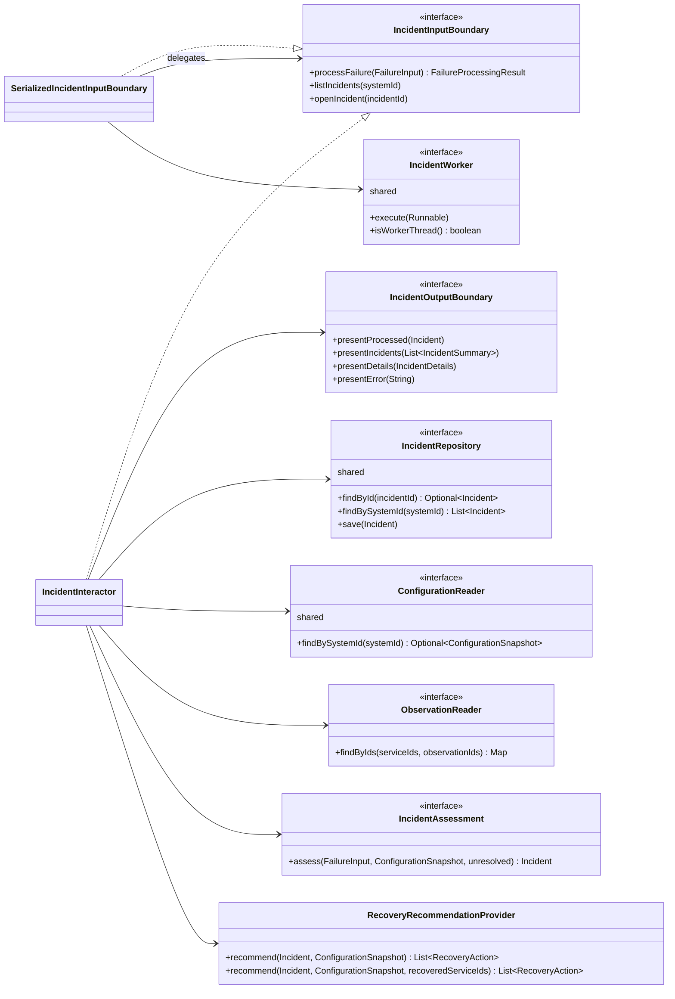
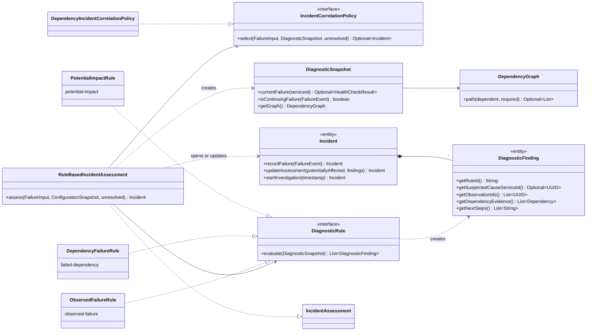
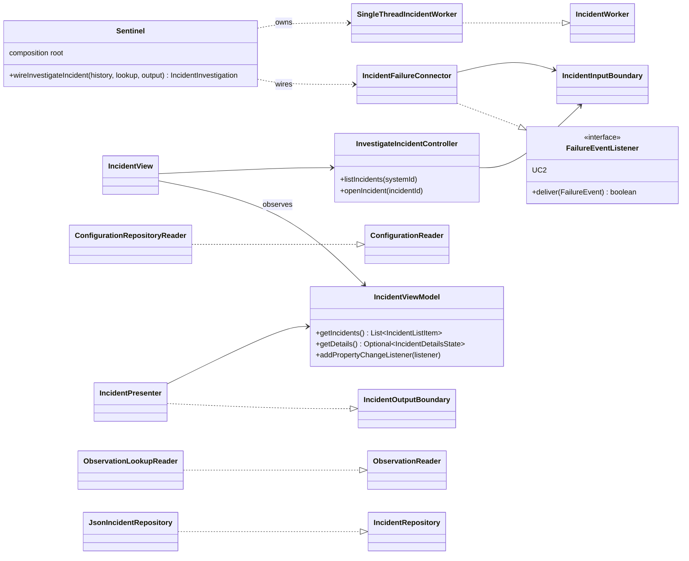
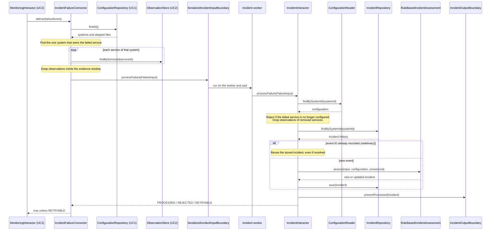
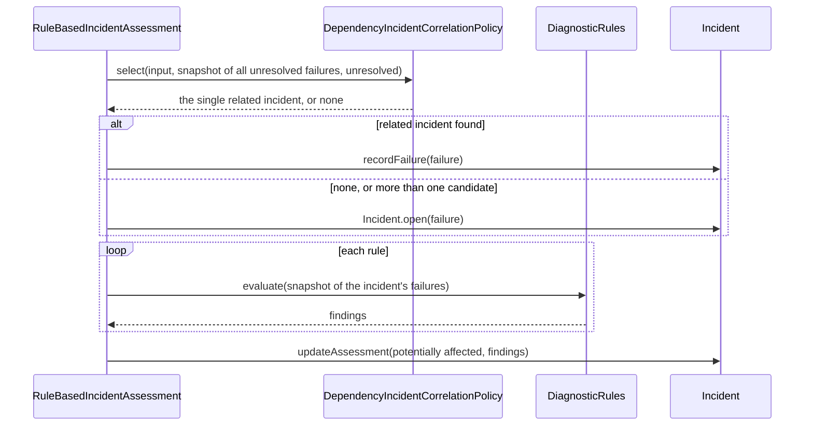
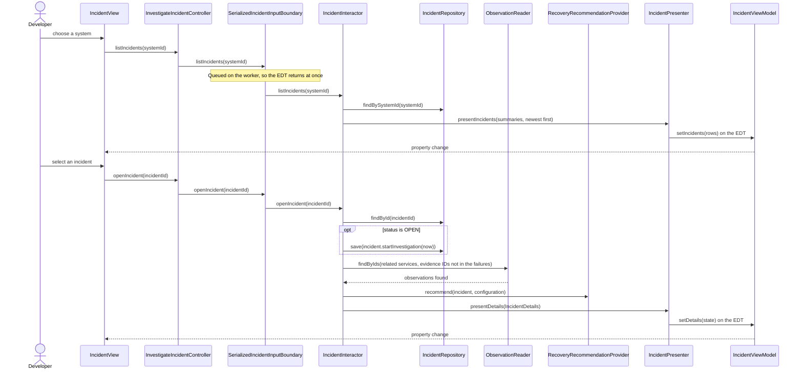

# UC3: Investigate an Incident — Architecture

This document explains how Use Case 3 is structured and why. The user-facing flow (preconditions, main
scenario and extensions) is in the [README](../README.md#use-case-3) and is not repeated here.

## Scope

UC3 turns failures detected by monitoring into incidents that a developer can investigate:

1. **Process a failure** that UC2 reports when a service crosses its failure threshold. UC3 correlates it with
   related unresolved failures, runs deterministic diagnostic rules, and saves the new or updated incident.
2. **List** a system's incidents, including resolved ones, newest first.
3. **Open** an incident. An open incident moves to investigating, and the developer sees its status, suspected
   causes, recorded failures, supporting evidence, potential impact, next steps and recommended recovery.

UC3 does **not** detect failures (that is UC2), edit configuration (UC1), or run recovery and resolve incidents
(UC4). Investigating an incident never changes a running service.

## Layer map

| Layer | Types | Notes |
|---|---|---|
| Entities (`entity`) | `Incident`, `FailureEvent`, `DiagnosticFinding`, `RecoveryAction`, `HealthCheckResult`, `MonitoredSystem`, `Service`, `Dependency` | Shared domain model. `Incident.restore` rebuilds a stored incident and checks its invariants. |
| Use case (`use_case.investigate_incident`) | `IncidentInputBoundary`, `IncidentInteractor`, `IncidentOutputBoundary`, `SerializedIncidentInputBoundary` | Boundaries, the interactor, and a wrapper that runs every call on the shared incident worker. |
| | `IncidentAssessment`, `RuleBasedIncidentAssessment` | Combines correlation and diagnosis into one new or updated incident. |
| | `IncidentCorrelationPolicy`, `DependencyIncidentCorrelationPolicy` | Strategy: decides which unresolved incident a failure joins. |
| | `DiagnosticRule`, `ObservedFailureRule`, `DependencyFailureRule`, `PotentialImpactRule` | Strategy: each rule turns a snapshot into findings. |
| | `RecoveryRecommendationProvider`, `DiagnosticSnapshot`, `DependencyGraph` | Pure helpers with no I/O. |
| | `ObservationReader` | Port UC3 owns, for loading evidence by ID. |
| | `FailureInput`, `FailureProcessingResult`, `IncidentSummary`, `IncidentDetails` | Immutable input and output data. |
| Shared (`use_case.shared`) | `IncidentRepository`, `IncidentDataException`, `IncidentWorker`, `ConfigurationReader`, `ConfigurationSnapshot` | Contracts shared with UC4. |
| Used from other use cases | UC1: `ConfigurationRepository`, `ConfigurationLoadResult`, `ConfigurationStoreException` | Read only, through adapters. |
| | UC2: `FailureEventListener`, `ObservationStore`, `ObservationLookup`, `ObservationStoreException` | UC3 implements UC2's listener and reads its observations through adapters. |
| Interface adapters (`interface_adapter.investigate_incident`) | `ConfigurationRepositoryReader`, `ObservationLookupReader`, `IncidentFailureConnector` | Adapters from UC1 and UC2 contracts to UC3's ports. |
| | `InvestigateIncidentController`, `IncidentPresenter`, `IncidentViewModel`, `IncidentListItem`, `IncidentDetailsState` | Controller, presenter and view model for the Incidents tab. |
| Frameworks and drivers | `JsonIncidentRepository`, `IncidentJsonCodec`, `JsonCodec` (`data_access.persistence`) | One JSON file per incident, written atomically. Gson stays in this layer. |
| | `SingleThreadIncidentWorker` (`infrastructure.scheduling`) | Implements `IncidentWorker`. |
| | `IncidentView`, `SentinelWindow` (`view`); `Sentinel` (`app`) | The Incidents tab, the four-tab window and the composition root. |

Every source dependency points inward. The use-case layer imports no Swing, Gson, file or thread-pool code,
and the composition root `app.Sentinel` is the only place that names concrete implementations.

## Class diagrams

### Boundaries and ports

The interactor also takes a `Clock`, so the time an incident moves to investigating can be fixed in tests.
`SerializedIncidentInputBoundary` wraps the interactor and is what the rest of the application calls.

### Diagnosis model (Strategy)

The rules and the policy are injected as a list and an interface, so a new rule is added at the composition
root without changing `RuleBasedIncidentAssessment`.

### Outer layers

## Sequence diagrams

### Process a failure from monitoring

UC2 calls the listener on its monitoring thread and waits for the result, which tells it whether to redeliver.

The connector returns `false` without calling UC3 when it cannot read the configuration or the observations
reliably, including when a skipped configuration file might own the service. UC2 keeps the event and
redelivers it with the same ID.

### Correlate and diagnose

### List and open an incident

`IncidentDetails` lists the evidence IDs that could not be loaded, and the presenter shows them as
unavailable. If opening the incident changed its status, the view asks for the list again so the row matches.

## Design decisions and tradeoffs

### Detection, correlation and diagnosis are separate
UC2 decides when a service has failed and emits one `FailureEvent` per threshold crossing. UC3 decides which
incident that failure belongs to (`IncidentCorrelationPolicy`) and what may explain it (`DiagnosticRule`).
Each has one reason to change. The rules differ on purpose: UC2 treats a monitoring error as unknown health and
starts a new streak, while UC3 treats only a passing check as the end of a failure. So `FAIL FAIL ERROR FAIL
FAIL` gives two failure events in UC2, and UC3 places both in one incident.

### Strategy for rules and correlation (Open/Closed)
`RuleBasedIncidentAssessment` runs an injected `IncidentCorrelationPolicy` and a list of `DiagnosticRule`s over
an immutable `DiagnosticSnapshot`. Rules do no I/O, do not change their inputs and never call Swing or other
use cases. Adding a rule means adding a class and one line at the composition root. Tradeoff: the snapshot has
to carry everything any rule might need.

### Conservative correlation
A failure joins an unresolved incident only when both failures are still continuing and they are the same
service or linked by a configured dependency path. Timing alone never links failures. If a failure could join
more than one incident, it opens a new one instead of guessing.

### Facts and hypotheses are kept apart
`observed-failure` findings record what failed and state that the cause is unknown. `failed-dependency`
findings name a suspected cause only when a required service failed at or before the dependent service, and
cite both checks and the dependency path. `potential-impact` findings name services that may be affected but
have no recorded failure. The presenter labels every cause as "suspected, not confirmed" and says "Cause
unknown" when no finding names one (extension 1a). Reassessment replaces the active findings and keeps the
earlier ones in the incident's history.

### Evidence is never invented
`openIncident` takes evidence from the failure events first and loads the rest by ID through
`ObservationReader`. The lookup is limited to services the incident refers to: failing services, services
named in its findings or their dependency paths, and services in its resolution evidence. IDs that cannot be
found are returned in `IncidentDetails` and shown as unavailable. When a system with several services has no
configured dependencies, the observed-failure findings say that dependency-based impact analysis is not
possible (extension 3a), so the lack of related findings is not mistaken for evidence of independence.

### Recommendations target the most upstream failure
`RecoveryRecommendationProvider` recommends a Docker container only for a failing service that does not require
another failing service outside its dependency cycle. HTTP services get the findings' manual next steps
(extension 5a). Action IDs come from the incident and service IDs, so they stay the same each time the incident
is opened. Recorded failures stay in an incident after a service recovers, so UC4 passes the services that have
recovered. Those no longer block the services that require them, and the next failing service downstream
becomes a target. The recovered service itself stays in the list, and UC4 decides not to restart it.

### Delivery contract and idempotency
`processFailure` returns `PROCESSED`, `RETRYABLE` (storage could not be read) or `REJECTED` (the input cannot be
processed, such as an unknown system). UC2 keeps a `RETRYABLE` event and redelivers it with the same ID. A
redelivered event ID returns its stored incident, even after UC4 has resolved it, so retries never create
duplicate incidents.

### One incident worker (Dependency Inversion)
`IncidentRepository.save` replaces a whole incident, so every read and write from UC3 and UC4 must run in order
on one thread. `SerializedIncidentInputBoundary` submits calls to the shared `IncidentWorker` port:
`processFailure` waits for its result, while `listIncidents` and `openIncident` return at once so the EDT never
blocks. A call made from the worker itself runs directly instead of deadlocking. `Sentinel` creates the
`SingleThreadIncidentWorker`, shares it and closes it; the boundary cannot shut it down. The thread is not a
daemon, so an accepted write finishes before the JVM exits, and it stops when idle so a forgotten `close()`
cannot keep the JVM alive.

### Adapters at the edges
`ConfigurationRepositoryReader` and `ObservationLookupReader` translate UC1's and UC2's exceptions into
`IncidentDataException`, which UC3 reports as `RETRYABLE`. `IncidentFailureConnector` adapts UC2's listener to
UC3's input:

- It finds the owning system through UC1's `findAll`. If the service isn't found and some configuration files
  were skipped, it asks UC2 to retry, because a skipped file might own the service.
- If two systems claim the same service, it reports the conflict and acknowledges the event, because
  redelivery cannot fix the configuration.
- It reads the owner's observations inside the evidence window and never sends UC3 a partial input.

### Persistence never skips an unreadable incident
`JsonIncidentRepository` stores one file per incident with a `schemaVersion`, writes through a temporary file
and an atomic move, and rebuilds incidents with `Incident.restore`, which checks every invariant. Unlike UC1's
configuration list, an unreadable incident file is an error, not a skipped file. Skipping an unresolved incident
would let a continuing failure open a duplicate. A file removed while it is being read counts as absent in
`findById`, and as an error while listing.

### Observer between presenter and view
`IncidentPresenter` turns output data into display text and updates `IncidentViewModel` on the EDT.
`IncidentView` listens for property changes and renders them, so the presenter and the use case never touch
Swing components. The view model holds only strings and IDs, and the view only forwards selections to the
controller. The Incidents tab takes its list of systems from UC1's presenter output, forwarded by the
composition root, so UC3 needs no query of its own for configured systems.

## Tests

| Check class | Covers |
|---|---|
| `entity.IncidentRestoreChecks` | `Incident.restore` accepts stored incidents and rejects broken invariants |
| `IncidentDiagnosisChecks` | Each rule, unknown causes, stale and conflicting evidence, cycles, systems without dependencies, correlation including ambiguous, interrupted, repeated and unrelated failures |
| `RecoveryRecommendationChecks` | Most upstream target, HTTP root causes, cycles, recovered services no longer blocking dependents, stable action IDs |
| `IncidentContractChecks` | Processing results, redelivery after resolution, removed services, the investigating transition, missing evidence, listing, service names, storage errors |
| `SingleThreadIncidentWorkerChecks` | Order, one non-daemon thread, idle exit and replacement, draining on close |
| `SerializedIncidentChecks` | Serialized calls, non-blocking UI requests, interruption, a closed worker, nested calls, sharing with recovery |
| `data_access.persistence.JsonIncidentRepositoryChecks` | Round trip of a full incident, failed saves, corrupt and misnamed files, dangling links, shared JSON formats |
| `interface_adapter.investigate_incident.IncidentReaderChecks` | Exception translation in both reader adapters |
| `interface_adapter.investigate_incident.IncidentFailureConnectorChecks` | Owner lookup, skipped files, conflicting owners, history failures, evidence window, result mapping |
| `interface_adapter.investigate_incident.IncidentPresenterChecks` | EDT updates, unknown and suspected causes, unavailable evidence, impact, recommendations, history |
| `app.IncidentMonitoringChecks` | UC2 to UC3 delivery, retry after a failed read, persistence across a restart, reopening with historical evidence |

`InvestigateIncidentCheckSuite` runs all of them. Compile with `mvn test-compile`, then run it from the project
root with Gson on the class path (`mvn dependency:copy-dependencies` copies it to `target/dependency`):

- PowerShell or Command Prompt: `java -cp "target/classes;target/test-classes;target/dependency/*" use_case.investigate_incident.InvestigateIncidentCheckSuite`
- macOS or Linux: `java -cp "target/classes:target/test-classes:target/dependency/*" use_case.investigate_incident.InvestigateIncidentCheckSuite`

## Known limitations

- **Monitoring is not connected in the desktop app yet.** UC2's observation store and scheduler are not in
  `main`, so `Sentinel` passes a placeholder store. The Incidents tab lists stored incidents, and evidence
  outside each failure event shows as unavailable. `IncidentMonitoringChecks` covers the connected path.
- **The Incidents tab recommends from recorded failures only.** UC3 cannot read service health history, so
  after a root cause recovers the tab still shows it and not its failing dependent. UC4's preview and execution
  pass recovered services and do target the dependent.
- **Every query reads every incident file.** Listing incidents and processing a failure parse all stored
  incidents, so they get slower as history grows.
- **Recover… stays disabled** until UC4's controller and view are wired.
