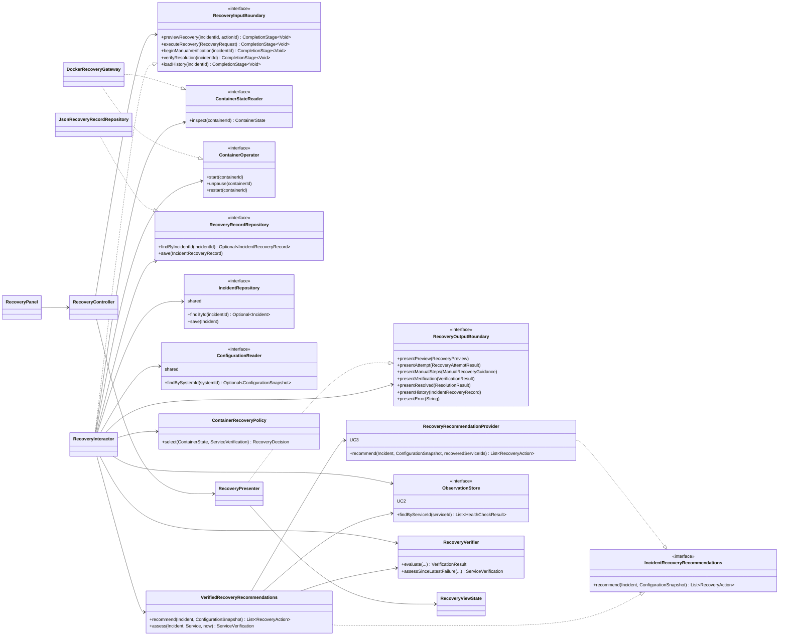
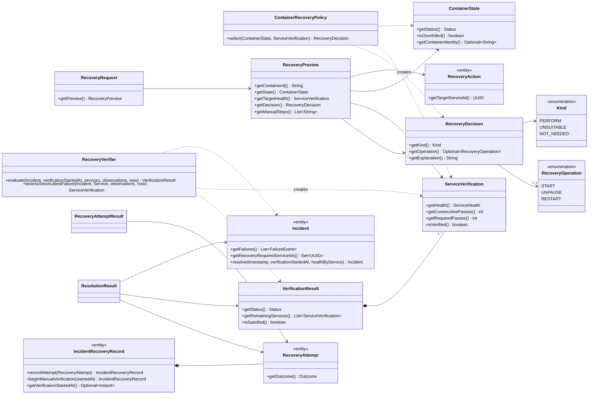
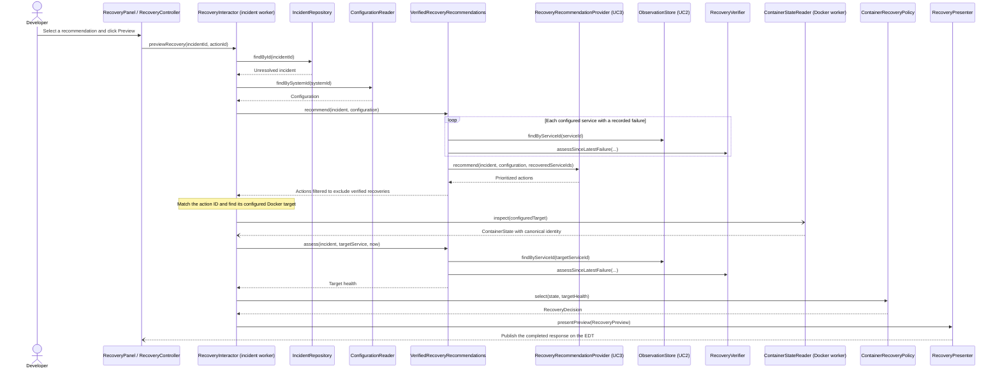
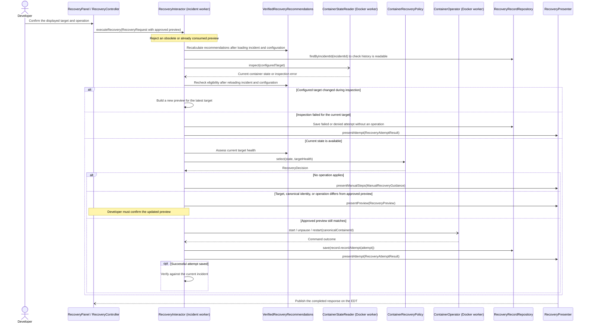
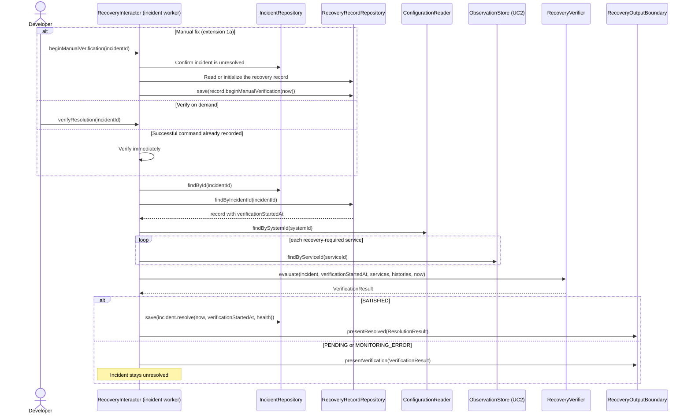

# UC4: Recover a Service and Verify Resolution — Architecture

This document explains how Use Case 4 is structured and why. The user-facing flow (preconditions, main
scenario and extensions) is in the [README](../README.md#use-case-4) and is not repeated here.

## Scope

UC4 lets a developer act on a recovery recommendation for an unresolved incident from the **Recovery** panel
in the **Incidents** tab.

1. **Preview** the recommended target container, its live state, the target service's recent health, and the
   operation Sentinel would run.
2. **Execute** that operation only after explicit confirmation, and record the attempt.
3. **Verify** recovery from fresh checks recorded by UC2's monitoring, and resolve the incident once every
   required service meets its recovery threshold.

If automatic recovery doesn't apply, UC4 shows the findings' manual next steps. The developer can then start
verification after fixing the problem outside Sentinel.

UC3 prioritizes recovery targets using the dependency graph. UC2 records health checks. UC4 runs
`START`, `UNPAUSE` and `RESTART`, each after explicit confirmation. The panel also displays the attempt history
and verification start saved for the selected incident.

## Layer map

| Layer | Types | Notes |
|---|---|---|
| Entities (`entity`) | `Incident`, `RecoveryAction`, `RecoveryAttempt`, `IncidentRecoveryRecord`, `Service`, `HealthCheckResult`, `ServiceHealth` | Shared domain model. `IncidentRecoveryRecord` holds UC4's attempts and verification start for one incident. |
| Use case (`use_case.recover_service`) | `RecoveryInputBoundary`, `RecoveryInteractor`, `RecoveryOutputBoundary` | Boundaries and the interactor that coordinates the ports. |
| | `ContainerRecoveryPolicy`, `RecoveryVerifier` | Pure decision logic with no I/O. |
| | `VerifiedRecoveryRecommendations` | Combines UC2 observation history, the verifier, and UC3's dependency-based recommendations. |
| | `ContainerStateReader`, `ContainerOperator`, `RecoveryRecordRepository` | Ports UC4 owns, implemented by outer layers. |
| | `RecoveryRequest`, `RecoveryPreview`, `RecoveryDecision`, `RecoveryAttemptResult`, `ManualRecoveryGuidance`, `ServiceVerification`, `VerificationResult`, `ResolutionResult`, `ContainerState`, `ContainerAccessException`, `RecoveryOperation` | Immutable input and output data. |
| Used from other use cases | UC3: `IncidentRecoveryRecommendations`, `RecoveryRecommendationProvider` | UC3 reads through the same recommendation query that UC4 uses to validate actions. |
| | UC2: `ObservationStore`, `ObservationStoreException` | UC4 only reads observation history. |
| | Shared: `IncidentRepository`, `IncidentDataException` | Incident storage shared with UC3. |
| | Shared: `ConfigurationReader`, `ConfigurationSnapshot` | Read-only system configuration shared with UC3. |
| | Shared: `IncidentWorker` | Serializes UC3 and UC4 incident access. |
| Interface adapters | `RecoveryController`, `RecoveryPresenter`, `RecoveryViewState` | Forward UI requests, format responses, and deliver view state on the EDT. |
| Frameworks and drivers | `DockerRecoveryGateway`, `JsonRecoveryRecordRepository`, `RecoveryPanel` | Docker adapter, local JSON storage, and Swing controls in the Incidents tab. |
| Composition root | `Sentinel` | Wires repositories, the shared incident worker, the dedicated Docker executor, and the clock. |

Source dependencies point inward. `Sentinel` supplies the concrete adapters and executors to the application layer.

## Class diagrams

### Boundaries and ports

The interactor also takes a `Clock` and a `Supplier<UUID>` for attempt IDs, so tests can control time and
identifiers. `Sentinel` also injects two executors. The diagram omits these scheduling and test dependencies.

### Decision and verification model

## Sequence diagrams

### Preview a recommended recovery

Preview reads the current incident, configuration, monitoring history, and Docker state. It creates a preview
for the developer to review before confirming a command.

If the action is unavailable, the incident is resolved or missing, or configuration no longer has a Docker target,
the interactor stops and presents an error or manual steps. Unreadable history can stop recommendation selection
before Docker inspection. An inspection error surfaces as an error and manual guidance.

### Execute a confirmed recovery

Confirmation consumes the exact preview presented to the developer. Execution reloads the incident, configuration,
and recommendations before and after Docker inspection, then evaluates target health and the proposed operation.

If the action disappears during revalidation, Sentinel clears the opportunity to execute it and reports an error
or manual guidance. A failed history write reports the command outcome alongside the storage error.

### Verify and resolve

Verification runs after a successful attempt is saved and whenever the developer clicks **Verify recovery**.
**Begin manual verification** saves a new verification start after a manual fix and evaluates progress immediately.
UC2 continues recording checks in the meantime.

## Design decisions and tradeoffs

### Thin interactor, pure policy and verifier (Single Responsibility)
`RecoveryInteractor` only reads data through ports, calls the pure classes, and presents results.
`ContainerRecoveryPolicy` decides which operation to run, and `RecoveryVerifier` decides whether a service has
recovered. Neither does any I/O, so both are tested directly with plain values. The cost is a few small
data classes (`RecoveryDecision`, `ServiceVerification`) passed between them.

### Ports and Dependency Inversion

`DockerRecoveryGateway` is the **Adapter** for `ContainerStateReader` and `ContainerOperator`. It reuses
the Docker client introduced in PR #13 and translates Engine responses into `ContainerState` and
`ContainerAccessException`. Separate ports give read-only callers access to inspection without granting
operation capabilities (Interface Segregation). The recovery command uses the canonical Docker ID from inspection.

### Re-derive everything at execution time
The preview and execution are separate calls. The incident, recommendations, container state, and service health
can change between them. When the configured target, Docker identity, or proposed operation changes and the action
is still eligible, Sentinel shows an updated preview and requires a new confirmation. This also protects against
Docker names being reassigned while a preview is open.

### Health guard on RESTART
Recorded failures remain after a service recovers. The recommendation query suppresses services that meet
recovery thresholds. The policy also checks the evidence when assessing a running container:

| Target health since its latest recorded failure | Running container |
|---|---|
| Meets its recovery threshold | `NOT_NEEDED`: nothing runs, and the reason and next steps are shown |
| Latest check failed | `RESTART` |
| Passes below the threshold | `RESTART`, explained as "N of M passes; recovery not confirmed" |
| No checks, or latest is a monitoring error | `RESTART`, explained as unknown health |

For an eligible target, a stopped or paused container is evidence of a problem by itself. The policy chooses
`START` or `UNPAUSE` from that state without applying the running-container health guard.
When health is unknown, we still allow the restart instead of blocking it. Otherwise a broken monitor would
leave the developer without automatic recovery. The explanation states what the checks show and doesn't claim
the service is failing, and confirmation is still required.

### Recovery uses a stricter rule than UC2 health
`RecoveryVerifier` needs a **trailing streak** of passes at least as long as the recovery threshold.
UC2's `HealthStateEvaluator` keeps a service `HEALTHY` until failures reach its failure threshold. With
failure threshold 2 and recovery threshold 3, `PASS PASS PASS FAIL` is `HEALTHY` in UC2 but `UNHEALTHY` here.
This is intentional: resolving an incident should need uninterrupted evidence, and the restart guard shouldn't
skip a service whose latest check failed. The two evaluators are not interchangeable.

### Explicit confirmation and manual guidance

`executeRecovery` requires a current, unused preview approved by the developer. The policy marks containers that
are restarting, OOM-killed, dead, being removed, or missing as `UNSUITABLE`. Sentinel shows the manual steps
from the incident's findings when an operation is unavailable.

### Reusing UC2's `ObservationStore`
UC4 reads history through UC2's `ObservationStore.findByServiceId` instead of having its own port, so there is
one source of truth for observations. It always reads the full history, and `RecoveryVerifier` selects the
window, so the windowing rule lives in one place. Storage failures are translated into `IncidentDataException`
so they go through the same error path as other data access. Tradeoff: `ObservationStore` also exposes
`save`, which UC4 never calls. A read-only interface would follow Interface Segregation more strictly, but it
would mean changing UC2's contract.

### Shared recommendation query

`VerifiedRecoveryRecommendations` assesses each configured failing service through `RecoveryVerifier`. It passes
verified service IDs to UC3's `RecoveryRecommendationProvider` so those services stop blocking downstream
recommendations. It also filters the recovered services themselves out of the provider's returned actions.
For example, if the database meets its threshold while the API still fails, the API can become eligible.
The original database failure stays in the incident history.

UC3 uses the query through `IncidentRecoveryRecommendations` when assembling details. UC4 uses the same query to
revalidate a preview or confirmation. This keeps the displayed and executable candidates aligned. The query's
since-failure assessment is separate from incident resolution, which requires fresh checks in a verification window.

### Worker handoffs and Swing output

UC4 and UC3 share one incident worker for repository access. Docker inspection and operations run on their own
executor, so UC3 can continue processing failures while Docker is busy. Verification reloads and saves the latest
incident in one shared-worker task. The application drains accepted monitoring and recovery work before closing
the shared worker.

The controller tracks the active request. The presenter formats its result into immutable `RecoveryViewState`
and delivers it on the Swing EDT. The panel drops responses for selections that changed while work was in flight.

### Recovery record persistence

`JsonRecoveryRecordRepository` stores one file per incident under `~/.sentinel/recovery/<incident-id>.json`.
The file contains the incident ID, ordered attempts, and the exact verification start when present. A missing
file represents empty recovery history. A read validates the filename, fields, attempt order, and verification
window. A write atomically replaces the file using a temporary file in the same directory. **Recovery history**
loads the record for the selected incident, including after restart.

## Tests

| Check class | Covers |
|---|---|
| `ContainerRecoveryPolicyChecks` | Operation per container state; unsuitable states; the restart guard's health cases; health ignored for stopped, paused and OOM containers |
| `RecoveryVerificationChecks` | Threshold, flapping, monitoring errors, verification and failure windows, dependents, unconfigured services, target-health assessment |
| `RecoveryInteractorChecks` | Confirmation, stale or unknown actions, manual steps, preview without side effects, re-inspection and re-assessment at execution, a recovered target not being restarted, attempt recording and failures, shared-worker interleaving, verification after restart, storage errors |
| `entity.IncidentRecoveryRecordChecks` | Attempt history and verification-start invariants |
| `JsonRecoveryRecordRepositoryChecks` | JSON round-trip, malformed records, failed write handling, manual verification timestamps |
| `DockerEngineInspectorChecks` | Simulated Engine inspection and recovery calls, permission errors, timeout, and replay protection |
| `RecoveryUiChecks` | Swing delivery on the EDT, request shutdown, and stale selection handling |

Compile with `mvn test-compile dependency:copy-dependencies`, then run each class from the project root, for example:

- PowerShell or Command Prompt: `java -cp "target/classes;target/test-classes;target/dependency/*" use_case.recover_service.RecoveryInteractorChecks`
- macOS or Linux: `java -cp "target/classes:target/test-classes:target/dependency/*" use_case.recover_service.RecoveryInteractorChecks`

## Known limitations

- **Uncertain Docker outcome.** The command is sent once. If the response is lost, the operation may have
  taken effect and Sentinel reports uncertainty.
- **Separate Docker and JSON writes.** A crash after the Docker command and before recording can leave an
  unrecorded attempt. If the app receives a write error, it reports both the command outcome and the error.
