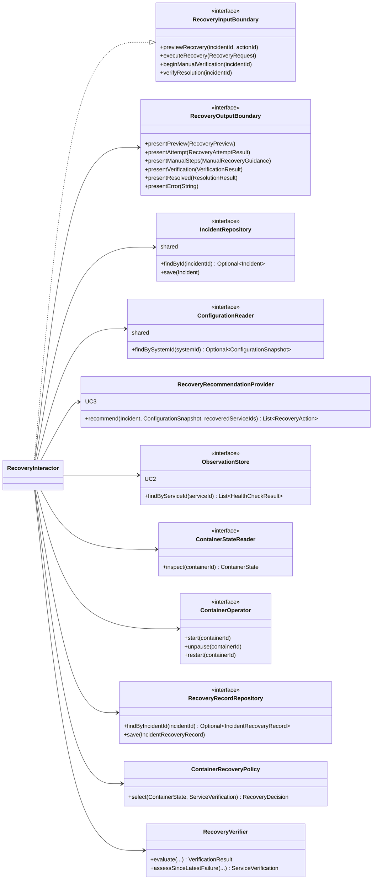
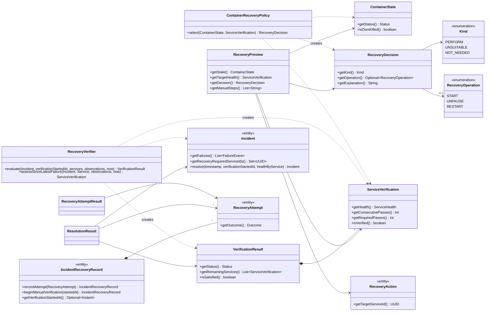
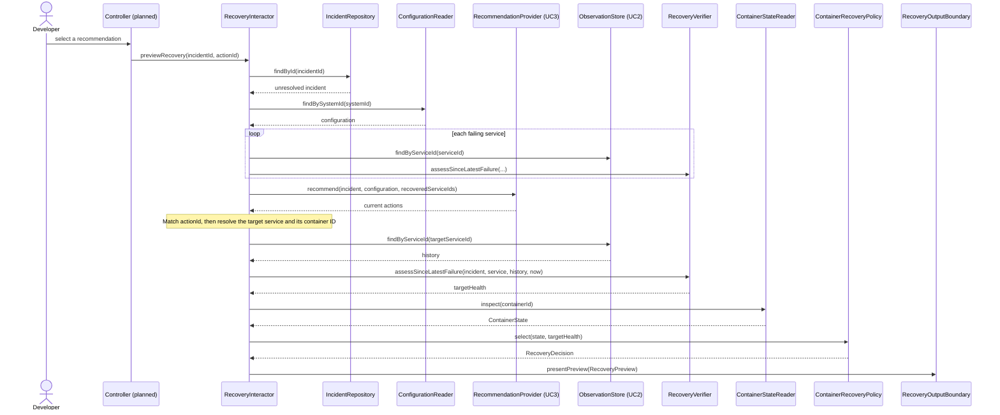
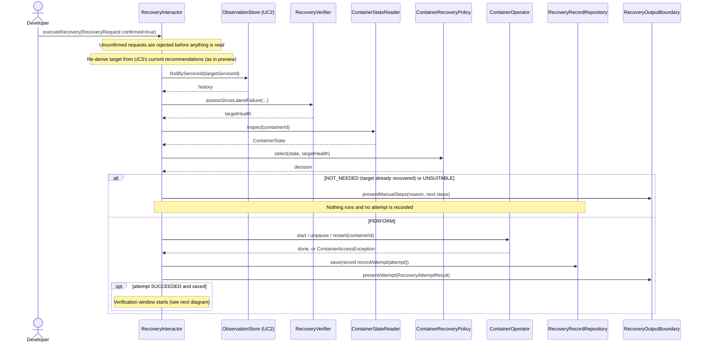
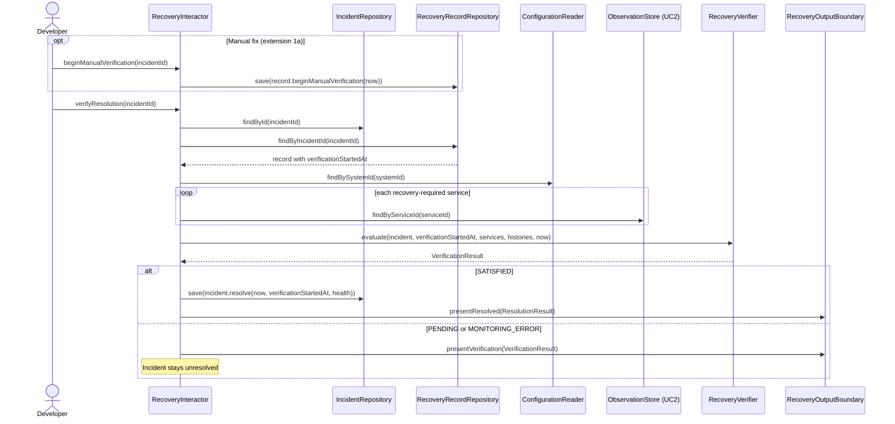

# UC4: Recover a Service and Verify Resolution — Architecture

This document explains how Use Case 4 is structured and why. The user-facing flow (preconditions, main
scenario and extensions) is in the [README](../README.md#use-case-4) and is not repeated here.

## Scope

UC4 lets a developer act on a recovery recommendation from UC3 for an unresolved incident:

1. **Preview** the recommended target container, its live state, the target service's recent health, and the
   operation Sentinel would run.
2. **Execute** that operation only after explicit confirmation, and record the attempt.
3. **Verify** recovery from fresh checks recorded by UC2's monitoring, and resolve the incident once every
   required service meets its recovery threshold.

If automatic recovery doesn't apply, UC4 shows the findings' manual next steps. The developer can then start
verification after fixing the problem outside Sentinel.

UC4 does **not** choose recovery targets (that is UC3), run health checks (UC2), or perform destructive
operations. The only operations it can run are `START`, `UNPAUSE` and `RESTART`, each after confirmation.

## Layer map

| Layer | Types | Notes |
|---|---|---|
| Entities (`entity`) | `Incident`, `RecoveryAction`, `RecoveryAttempt`, `IncidentRecoveryRecord`, `Service`, `HealthCheckResult`, `ServiceHealth` | Shared domain model. `IncidentRecoveryRecord` holds UC4's attempts and verification start for one incident. |
| Use case (`use_case.recover_service`) | `RecoveryInputBoundary`, `RecoveryInteractor`, `RecoveryOutputBoundary` | Boundaries and the interactor that coordinates the ports. |
| | `ContainerRecoveryPolicy`, `RecoveryVerifier` | Pure decision logic with no I/O. |
| | `ContainerStateReader`, `ContainerOperator`, `RecoveryRecordRepository` | Ports UC4 owns, implemented by outer layers. |
| | `RecoveryRequest`, `RecoveryPreview`, `RecoveryDecision`, `RecoveryAttemptResult`, `ManualRecoveryGuidance`, `ServiceVerification`, `VerificationResult`, `ResolutionResult`, `ContainerState`, `ContainerAccessException`, `RecoveryOperation` | Immutable input and output data. |
| Used from other use cases | UC3: `RecoveryRecommendationProvider` | UC4 re-derives UC3's recommendations rather than trusting a stale list. |
| | UC2: `ObservationStore`, `ObservationStoreException` | UC4 only reads observation history. |
| | Shared: `IncidentRepository`, `IncidentDataException` | Incident storage shared with UC3. |
| | Shared: `ConfigurationReader`, `ConfigurationSnapshot` | Read-only system configuration shared with UC3. |
| Interface adapters | *Planned:* recovery controller, presenter, view model | Presenters must marshal Swing updates onto the EDT. |
| Frameworks and drivers | *Planned:* Docker Engine adapter (`ContainerStateReader`, `ContainerOperator`), JSON `RecoveryRecordRepository`, Swing view | Not implemented yet. |

Every source dependency points inward. The interactor depends only on interfaces and pure classes, and the
concrete adapters will be wired at the composition root.

## Class diagrams

### Boundaries and ports

The interactor also takes a `Clock` and a `Supplier<UUID>` for attempt IDs, so tests can control time and
identifiers. They are left out of the diagram.

### Decision and verification model

## Sequence diagrams

### Preview a recommended recovery

Nothing changes during a preview. Every input is read fresh.

If the action is no longer recommended, the incident is resolved or missing, or the target isn't a
container, the interactor presents an error or manual steps instead and stops early. If observations can't be
read, it presents an error and doesn't inspect the container.

### Execute a confirmed recovery

Execution repeats every check from the preview rather than trusting it, because the container and the service
may have changed in the meantime.

If the container can't be inspected, a `FAILED` (or `PERMISSION_DENIED`) attempt is recorded with no
operation. That way the developer has a record that recovery was tried.

### Verify and resolve

Verification runs right after a successful attempt and again whenever `verifyResolution` is called. Monitoring
keeps recording checks in the meantime. `beginManualVerification` opens the same window after a manual fix.

## Design decisions and tradeoffs

### Thin interactor, pure policy and verifier (Single Responsibility)
`RecoveryInteractor` only reads data through ports, calls the pure classes, and presents results.
`ContainerRecoveryPolicy` decides which operation to run, and `RecoveryVerifier` decides whether a service has
recovered. Neither does any I/O, so both are tested directly with plain values. The cost is a few small
data classes (`RecoveryDecision`, `ServiceVerification`) passed between them.

### Ports and Dependency Inversion; Docker access goes through an Adapter
The interactor depends on `ContainerStateReader` and `ContainerOperator`, not on a Docker client. The planned
Docker Engine adapter will translate API responses and errors into `ContainerState` and
`ContainerAccessException` (an **Adapter**). The two container ports are separate (Interface Segregation), so
code that only needs to inspect a container can't also operate on it.

### Re-derive everything at execution time
The preview and execution are separate calls, and the incident, recommendations, container state and service
health can all change between them. So execution re-derives the action from UC3's current recommendations,
inspects the container again, and assesses health again. A stale preview can never authorize an operation.

### Health guard on RESTART
UC3 picks targets from recorded failures, which remain after a service recovers. Before this guard, a
running container was restarted on the assumption that its service was failing, even if it had since passed
its checks. For example, the DB has recovered but the API is still failing, so the incident stays open and
the DB is still recommended. Now:

| Target health since its latest recorded failure | Running container |
|---|---|
| Meets its recovery threshold | `NOT_NEEDED`: nothing runs, and the reason and next steps are shown |
| Latest check failed | `RESTART` |
| Passes below the threshold | `RESTART`, explained as "N of M passes; recovery not confirmed" |
| No checks, or latest is a monitoring error | `RESTART`, explained as unknown health |

A stopped or paused container is evidence of a problem by itself, so `START` and `UNPAUSE` ignore health.
When health is unknown, we still allow the restart instead of blocking it. Otherwise a broken monitor would
leave the developer without automatic recovery. The explanation states what the checks show and doesn't claim
the service is failing, and confirmation is still required.

### Recovery uses a stricter rule than UC2 health
`RecoveryVerifier` needs a **trailing streak** of passes at least as long as the recovery threshold.
UC2's `HealthStateEvaluator` keeps a service `HEALTHY` until failures reach its failure threshold. With
failure threshold 2 and recovery threshold 3, `PASS PASS PASS FAIL` is `HEALTHY` in UC2 but `UNHEALTHY` here.
This is intentional: resolving an incident should need uninterrupted evidence, and the restart guard shouldn't
skip a service whose latest check failed. The two evaluators are not interchangeable.

### Explicit confirmation; nothing destructive
`executeRecovery` rejects unconfirmed requests before reading anything. Containers that are restarting, were
OOM-killed, are dead, are being removed or are missing are `UNSUITABLE`, and Sentinel shows the manual steps
instead. Sentinel never removes containers or kills processes.

### Reusing UC2's `ObservationStore`
UC4 reads history through UC2's `ObservationStore.findByServiceId` instead of having its own port, so there is
one source of truth for observations. It always reads the full history, and `RecoveryVerifier` selects the
window, so the windowing rule lives in one place. Storage failures are translated into `IncidentDataException`
so they go through the same error path as other data access. Tradeoff: `ObservationStore` also exposes
`save`, which UC4 never calls. A read-only interface would follow Interface Segregation more strictly, but it
would mean changing UC2's contract.

### Direct dependency on UC3's recommendation provider
UC4 calls UC3's concrete `RecoveryRecommendationProvider` so that the preview and execution use exactly the same
rule the incident view shows. The class is pure, so this is easy to test, but any change to how UC3 chooses
targets also changes UC4's behaviour.

## Tests

| Check class | Covers |
|---|---|
| `ContainerRecoveryPolicyChecks` | Operation per container state; unsuitable states; the restart guard's health cases; health ignored for stopped, paused and OOM containers |
| `RecoveryVerificationChecks` | Threshold, flapping, monitoring errors, verification and failure windows, dependents, unconfigured services, target-health assessment |
| `RecoveryInteractorChecks` | Confirmation, stale or unknown actions, manual steps, preview without side effects, re-inspection and re-assessment at execution, a recovered target not being restarted, attempt recording and failures, verification and resolution, storage errors |
| `entity.IncidentRecoveryRecordChecks` | Attempt history and verification-start invariants |

Compile with `mvn test-compile`, then run each class from the project root, for example:

- PowerShell or Command Prompt: `java -cp "target/classes;target/test-classes" use_case.recover_service.RecoveryInteractorChecks`
- macOS or Linux: `java -cp "target/classes:target/test-classes" use_case.recover_service.RecoveryInteractorChecks`

## Known limitations

- **No adapters or UI yet.** The Docker adapter, JSON recovery-record repository, presenter and Swing view
  are still to be built, as is the composition-root wiring.
