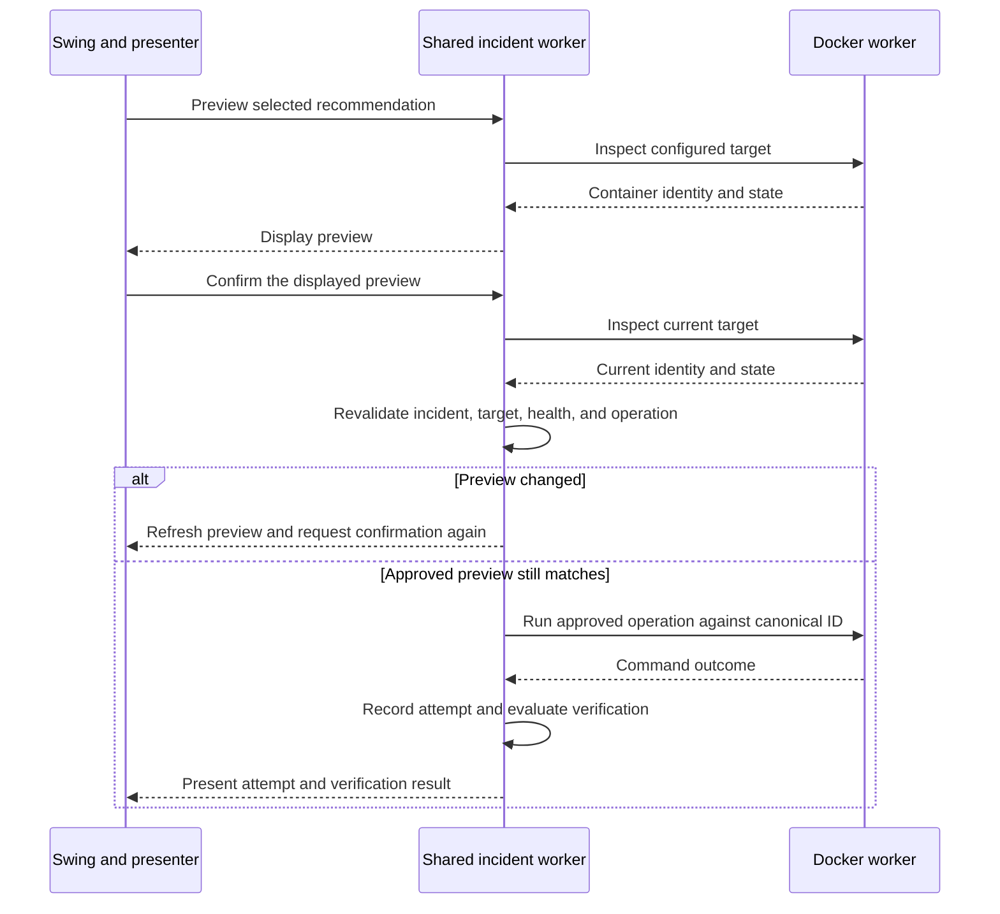

# UC4 recovery architecture

UC4 lets a developer preview and approve a Docker recovery operation from an incident, inspect its recorded
outcome, and resolve the incident once monitoring supplies enough fresh passing checks. The incident details
also show manual steps from the active findings. See the [README](../README.md#how-to-run) for the Swing flow.

## Responsibilities

| Layer | Types and responsibilities |
| --- | --- |
| Entities | `Incident` owns the resolution transition and evidence. `IncidentRecoveryRecord` owns the ordered `RecoveryAttempt` history and verification start. |
| Application | `RecoveryInteractor` coordinates the ports. `ContainerRecoveryPolicy` selects an operation. `RecoveryVerifier` evaluates observations. `VerifiedRecoveryRecommendations` combines the verifier with UC3’s dependency-based recommendation provider. |
| Interface adapters | `RecoveryController` forwards Swing commands and tracks accepted work. `RecoveryPresenter` formats preview, attempt, and verification output into immutable request state and delivers it on the EDT. |
| Infrastructure | `DockerRecoveryGateway` translates Engine calls into the `ContainerStateReader` and `ContainerOperator` ports. `JsonRecoveryRecordRepository` implements `RecoveryRecordRepository`. `RecoveryPanel` renders the controls in the Incidents tab. |
| Composition | `Sentinel` injects the ports, shared incident worker, Docker executor, and clock. UC3 and UC4 share the incident repository and verifier-backed recommendation query. |

The Docker Adapter centralizes translation of external status codes, identity, lifecycle, and errors. UC4 shares
the Docker transport and inspect implementation from PR #13 with UC2. The application ports make it possible to
test policy and orchestration with fake containers. Docker and Gson stay in the outer layers.

## Preview and confirmation

A preview uses the current incident, service configuration, health history, and Docker inspection. The operation
policy supports start, unpause, and restart. It provides guidance for unsuitable states such as a missing,
restarting, or OOM-killed container. Manual next steps come from the incident’s findings.

Confirmation consumes the exact preview that was presented. UC4 rechecks eligibility and configuration before
and after Docker inspection. It compares the target service, configured target, canonical Docker container ID,
and operation against the approved preview. When any of these change, UC4 returns a fresh preview when the action
is still available. The developer must confirm it separately. The Docker command uses the approved canonical ID,
including when configuration identifies a container by name.

Incident and recovery-record reads and writes use the same serialized worker as UC3. Docker I/O can run while
UC3 processes failures. The completion callback reloads the incident for verification and saves the resolved
incident in the same worker task. Window close drains accepted recovery and monitoring work before shutting down
the shared worker. The panel discards late display results if the user changes incident selection.

## Recommendations and verification

UC3 decides candidate priority from the dependency graph. The shared query supplies service IDs that meet their
recovery thresholds so downstream failures can become eligible, then filters out the recovered services themselves.
The verifier uses the trailing streak of passing observations after each service’s latest incident failure.
It treats monitoring errors as unknown health and resets that streak when the latest check fails.

Resolution also requires a verification start from an accepted Docker operation or manual verification. UC4 reads
UC2’s observation history and counts qualifying checks at or after that start and after each service’s latest
failure. Every recovery-required service must satisfy its threshold. The resolved incident stores the passing
evidence used in that decision.

## Persistence and failure behavior

Recovery data is stored in `~/.sentinel/recovery/<incident-id>.json` alongside the incident store. Each file holds
the incident ID, ordered recovery attempts, and the verification start when present. A missing file represents
an incident with no recovery history. Reads validate the filename, fields, attempt order, and verification window.
Writes replace the record atomically using a temporary file in the same directory.

Docker can complete an operation even if a response is lost. A transport failure reports uncertainty and the
gateway sends the mutation once. Docker mutation and the local file write are separate operations. If writing
fails after a command, Sentinel reports the command outcome alongside the recording error. A process crash
between these operations can leave an unrecorded attempt.

## Checks

The executable checks cover the recovery policy and verification thresholds, shared-worker handoffs, stale
confirmation, a simulated Docker Engine, recovery JSON round-trips, and resolution after reopening persisted
records. See the [README](../README.md#how-to-run) for commands.
